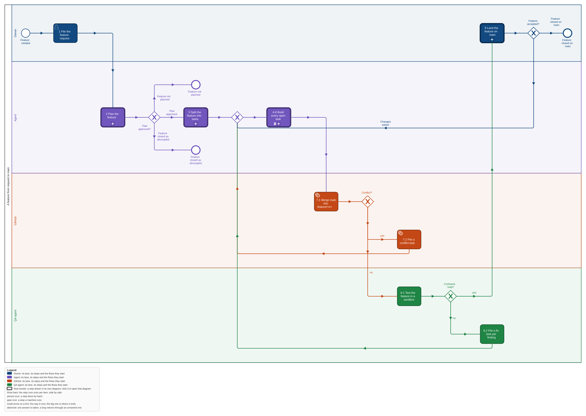
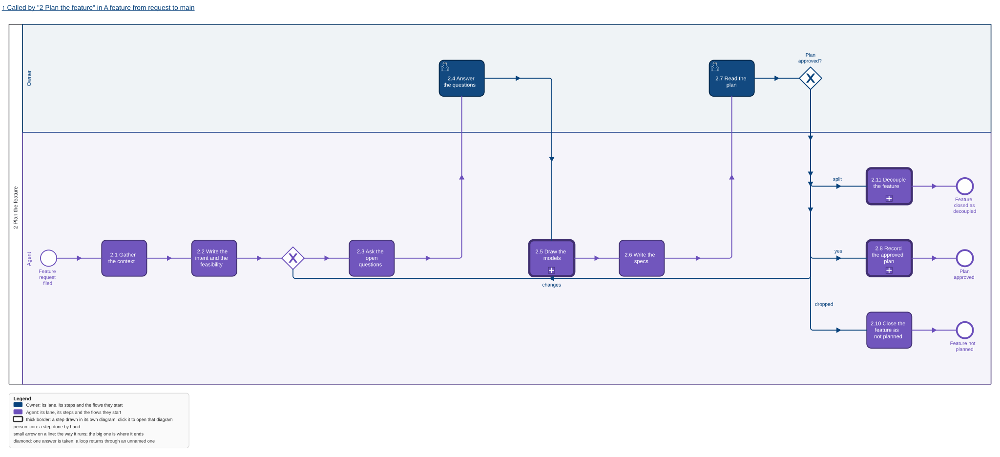
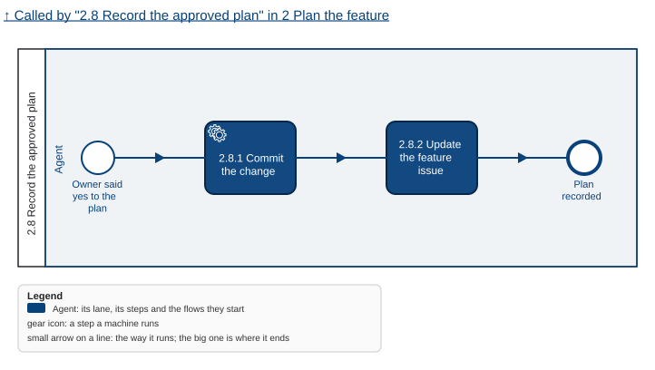
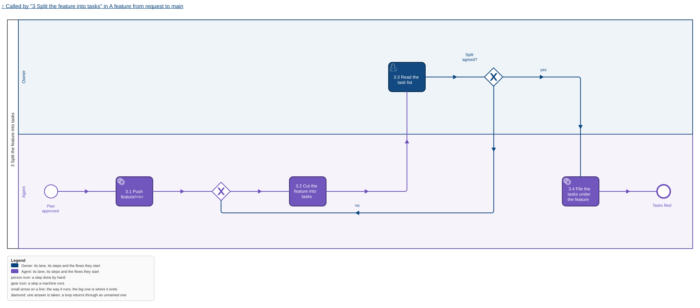
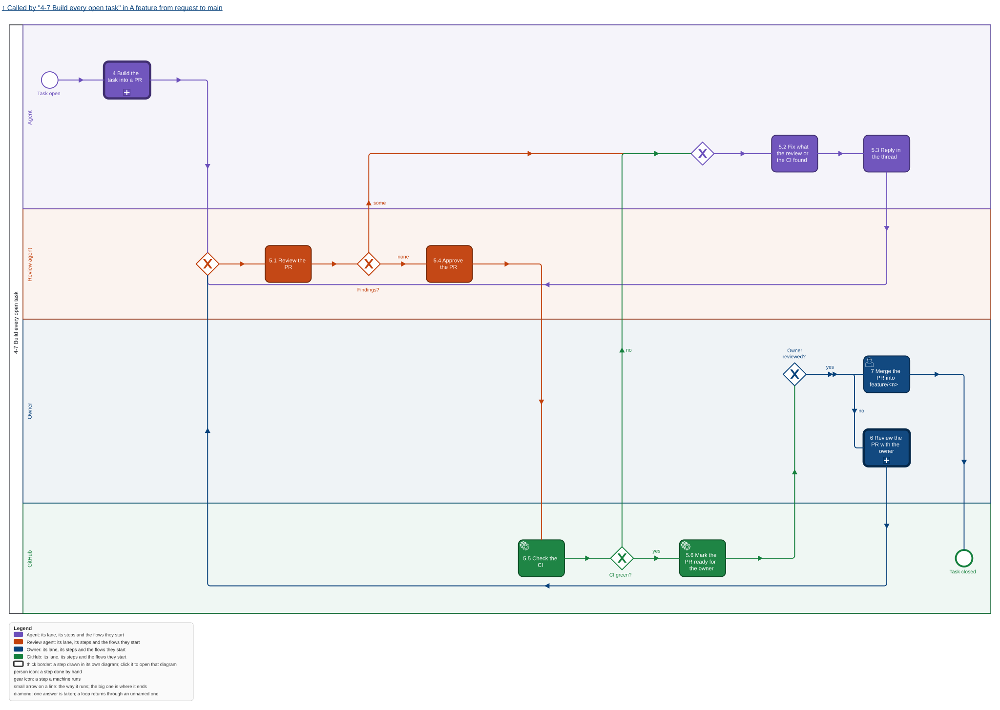
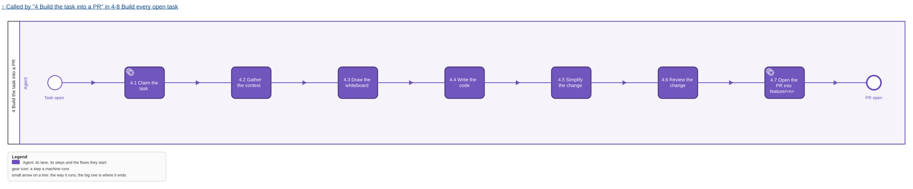
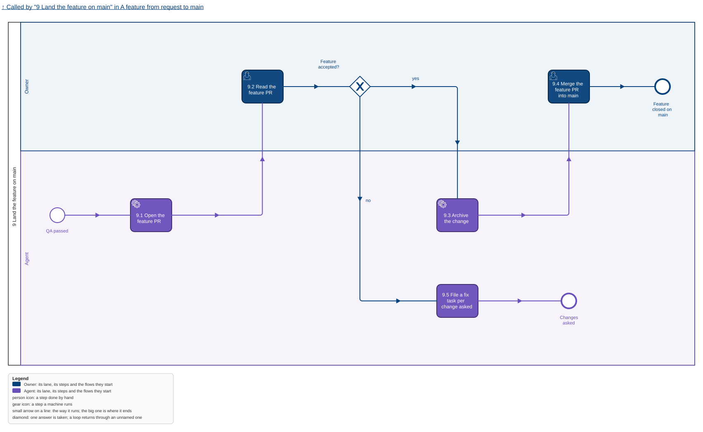
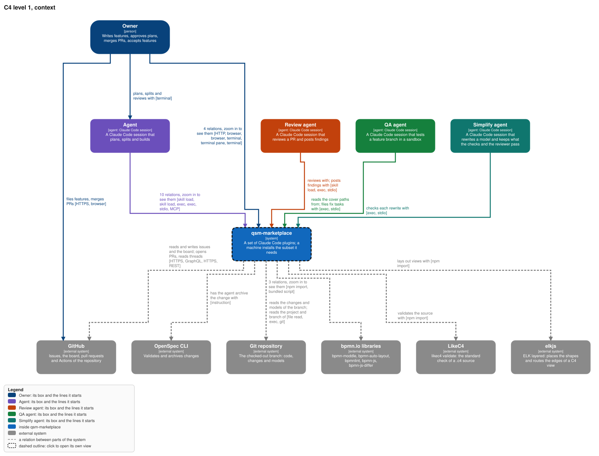
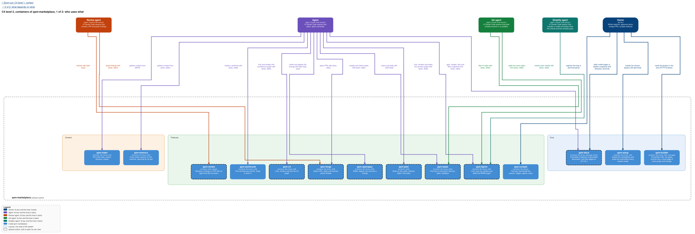
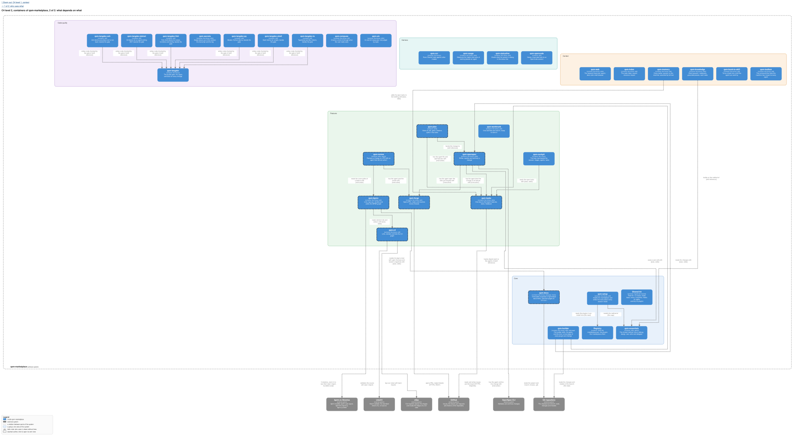

Each `.bpmn` opens in bpmn.io; each `.drawio.svg` opens editable in draw.io.

## Why

The owner works near the loop and wants to see what is planned, built and released, and why.
Today a change is one long file of text with no picture, the parent of tasks is an epic GitHub
does not know, and the plan of every task is written before anyone has built anything. This
feature makes a feature the unit of work end to end: a request through a form, a plan that opens
with models, tasks cut at the start of the build, each one a pull request a person can review, and
one feature pull request whose merge into main is the owner's accept.

## What

- **A feature change has its own OpenSpec schema**, `feature`: proposal (one screen), models
  (BPMN and C4, each with its picture), specs (scenarios cite the BPMN's cover paths), design
  (decisions only). It has no tasks artifact.
- **Step 1, the request**: two issue forms, feature request and issue, whose fields are the five
  questions of the implementation rule.
- **Step 2, planning** writes the change models first, and its plan opens with a Feasibility
  section: what can be done, what cannot and why, and how many task pull requests it
  takes, which the owner reads before his yes. After the yes in the session it commits the change
  onto the local branch `feature/<n>` and updates the feature issue with a one-screen summary. A
  request too big for one feature ends in a proposed split: after the yes the agent files one new
  feature issue per part, each planned on its own, and closes the original with a comment linking
  them. It opens no pull request and creates no task.
- **Step 3, the split**: the owner and the agent cut the feature into tasks, each a reviewable
  pull request, with fakes that let each part run; `feature/<n>` is pushed first.
- **Step 4, a task is built in one session**: context first, a whiteboard in the chat, the code,
  `/simplify`, a self-review, then a pull request into `feature/<n>` from the template.
- **Step 5** is the existing review workflow, reading the task against its feature's change.
- **Step 9**: the agent opens the feature pull request to main with before and after for the
  whole feature; after the owner accepts it the agent archives the change and the owner merges.

## Not in this feature

The binary and its Action (`qsm-tasks-cli`), the move off `br` (`tasks-on-github-issues`), the
model tool (`strict-visual-models`), the QA agent of step 8 (`qa-agent`), a separate identity for
agents (`agent-identity`), the release train (`release-train`), and planning without the owner.

## Features that follow from the flow

The owner picks from this table. Order is a suggestion: the same number can run side by side.

| Order | Feature (change) | Intent | Depends on | State |
| --- | --- | --- | --- | --- |
| 1 | `qsm-tasks-cli` | One binary is the agents' only door to the board; an Action derives a feature's Status, brings `feature/<n>` up to date with main, and closes the tasks a merge into `feature/*` names | nothing | spec, revised to this flow |
| 1 | `strict-visual-models` | One BPMN and one C4 graph per project with one tool that lints, renders, walks and link-checks them | `qsm-docs` (epic qsm-vgw0) | spec, revised to epic qsm-vgw0 |
| 2 | `tasks-on-github-issues` | The skills and plugins stop using `br`; a change is bound to its feature | `qsm-tasks-cli` | spec, revised to this flow |
| 3 | `feature-flow` | The feature schema and steps 1 to 6 and 9 | `qsm-tasks-cli`, `tasks-on-github-issues`, `strict-visual-models` | spec, this change |
| 4 | `qa-agent` | Step 8: a QA agent deploys `feature/<n>` to a sandbox and runs the scenarios of the feature's cover paths as a blackbox | `feature-flow`, `strict-visual-models` | stub |
| 1 | `agent-identity` | Agents open and review pull requests as `qsmark-bot`, so the owner's approval is a gate GitHub enforces | built with `qsm-tasks-cli` | stub, decided |
| 6 | `release-train` | Versions, a two-week release, release notes from released items, then archive | `qsm-tasks-cli` | parked |
| later | automatic planning | Step 2 runs on a new feature request without the owner, who reviews the result | `feature-flow`, `qa-agent` | not a change yet |

## Decisions of the owner

1. **Features, no epics** (2026-11-01): "we removed epics fully". A feature is GitHub's default
   issue type Feature; a task is a sub-issue; feedback is a plain issue from a
   template.
2. **Strict visual models everywhere** (2026-11-01): "vsude strict defined theorem visual models,
   tak aby bylo jasne na vsechny strany really co chceme". BPMN is behaviour, C4 is structure.
3. **Near the loop** (2026-11-01): "I want to take the problem apart and know about it." Specs
   today are "one huge useless file with insane amount of text. No visibility or visuals for
   anything."
4. **The feature branch and the accept** (2026-11-01): `feature/<n>` at the split, task pull
   requests target it, a conflict with main is resolved and reviewed before QA, and the feature
   pull request to main is the accept; QA catches contract and business bugs, never code bugs:
   "QA ma chytat contract a business bugs, ne codebugs".
5. **GitHub first** (2026-10-30): "i dont want to duplicate anything that github already has a
   way to do normally".
6. **Task pull requests stay reviewable** (2026-11-06): the required check `pr-size` fails one
   past 400 changed lines; a file `.gitattributes` marks generated, a BPMN's layout included, is
   not counted, because a model is read through its picture.
7. **No budget** (2026-11-07): "nemam budget, jen zakladame tasky, a ty tasky plnime". The
   implementation rule asks five questions, the forms ask five, and Feasibility counts the task
   pull requests instead of measuring a budget.
8. **Pictures first, least text** (2026-11-07): "aby kdokoliv - hlavne ja, se mohl podivat na
   feature a hned mel nejaky idea o tom co, kam, a proc se bude davat. Chceme kazdym krokem,
   kazdym toolem, vsim co ted delame maximalne pomoct userovi zmensit mental load."
