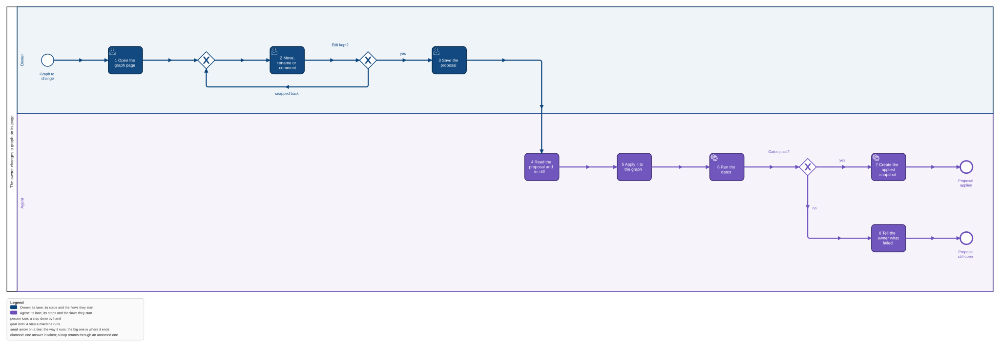
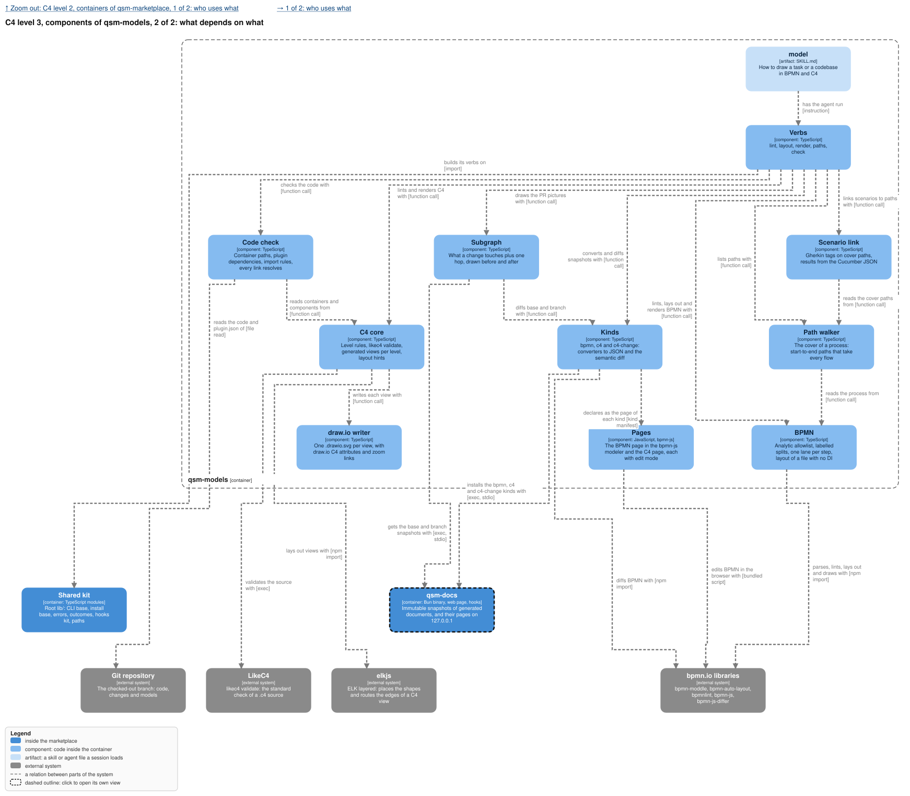

The Kinds and Pages components of qsm-models in `../feature-flow/models/marketplace.c4` are this
change; the store and page shell are `qsm-docs`.

## Why

The owner reads a project's business processes and architecture and asks for changes, and today he
can only read a committed SVG and describe what he wants in words. This feature puts each graph on
a page of qsm-docs where he can walk it, from the main process into every called process and from
the context down to the components, and change it in place: every edit he saves is a proposal the
agent applies through the gates. It is the third piece of epic qsm-vgw0.

## What

- **Three kinds, installed into qsm-docs by qsm-models**: `bpmn` (the full BPMN XML), `c4` (the
  `.c4` source) and `c4-change` (a parent `c4` snapshot and a list of changes: move, rename,
  comment, add, remove), each with its converter to JSON and its diff.
- **The BPMN page**: the static page of `strict-visual-models` (line 12) grown into the bpmn-js
  modeler, a task that is dragged into another lane snaps back,
  call activities open the process they call, into another project's latest snapshot on main too.
- **The C4 page**: context, containers, and components where they exist; a container dragged out
  of its system snaps back; each node with a verified commit says how many commits ago.
- **Edit mode**: a BPMN edit is saved as a full XML snapshot, a C4 edit as a `c4-change`, each with
  its parent. `qsm-docs diff` names each rename, move and comment.
- **Gherkin notes on a task**: the owner writes scenarios on a business task's details page; they
  are saved with the next proposal in the task's standard `documentation` element (`textFormat`
  `text/x-gherkin`), and `qsm-models gherkin <graph> [--task <id>]` prints them as `.feature` text.
- **An applied move stays**: BPMN keeps it in its geometry, C4 as layout hints, so the next render
  draws it where the owner put it.

## Not in this feature

A general BPMN or C4 editor (no new element types, no palette beyond move, rename, comment, add,
remove and Gherkin notes), an automatic apply, any link between Gherkin and tests (no tags, no
results, no generation in either direction), the PR pictures (`models-pr-pictures`), the lens.

## Decisions of the owner

1. **Pages on qsm-docs, kinds from qsm-models** (2026-11-04, epic qsm-vgw0): "qsm-docs knows
   nothing of BPMN or C4: `qsm-models` adds the kinds `bpmn`, `c4` and `c4-change`".
2. **Every edit is a proposal** (2026-11-04): "The model source changes only when the agent applies
   a proposal and the gates pass; an applied move becomes a layout hint the renderer keeps".
3. **bpmn-js and bpmn-js-differ 3.2.0** (2026-11-04): the libraries to start from.
4. **Gherkin notes, nothing more** (2026-11-05): the owner writes scenarios on a business task's
   details page; they live in the task's `documentation` and `qsm-models gherkin` prints them. "No
   Gherkin-to-tests link at all": no tags, no results, no generation. This replaces the change
   `models-scenarios`, which is removed.
5. **The first build comes before these pages** (2026-11-05): `strict-visual-models` writes static
   pages first; these pages replace them as kinds of qsm-docs, with edit mode.

## Critiques

- **Devil's advocate: a full XML snapshot per BPMN edit is heavy.** The marketplace graph will be
  some hundred KB, a snapshot per save. Waived: one person saves a few times a day, and the
  immutable store is the owner's decision; a C4 edit is a small change list because `.c4` text has
  no geometry to carry.
- **Devil's advocate: the page shows a snapshot, not the committed file.** In repo mode the file in
  the checkout can be ahead of the newest snapshot. Fixed: the page says when the checkout's file
  differs from the snapshot it shows, and the agent snapshots after each commit of the graph.
- **Devil's advocate: a comment is not model content.** Fixed: a comment is the owner's note to
  the agent; the agent answers it by changing the graph or replying, and never writes it into the
  source. On the BPMN page it is a text annotation in the proposal only.
- **Future archaeologist: why two kinds for C4.** Design decision 2: the `.c4` text has no geometry
  and the owner's edit is a few operations; storing the operations makes the diff exact and the
  apply reviewable.
- **Future archaeologist: why another project opens on its main snapshot.** The epic's rule:
  another project's graph opens on its latest snapshot on main, so a link never shows a branch's
  work in progress.
- **Scope sniper: `add` and `remove` in `c4-change`.** The epic names them; kept, and the page
  offers them only on a container or a component, never a kind or a view.
- **Scope sniper: two new verbs, `convert` and `diff`.** Needed: the kind manifest names commands,
  and qsm-docs reaches qsm-models only through them.
- **Conflict named: the prototype pipeline still wants a C4 actor per lane.** This change's BPMN
  uses Owner and Agent, which are C4 actors, so it renders today; the rule goes with
  `strict-visual-models`.
- **Devil's advocate: notes with no test link rot like any text.** Waived by the owner's decision 4:
  the scenarios are notes the owner reads and exports, and a link to tests is the thing he refused.
- **Devil's advocate: `documentation` is read by other tools.** BPMN tools show it as the element's
  documentation; `textFormat` says what it is, so one that does not know `text/x-gherkin` shows
  plain text. Accepted.
- **Scope sniper: one more verb, `gherkin`.** Needed: the export is the owner's only way to get the
  notes out of the XML without opening the page.
