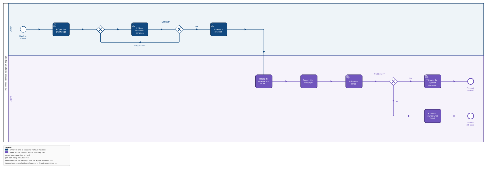

The Kinds and Pages components of qsm-bpmn in `models/marketplace.c4` are this change; the store
and page shell are `qsm-docs`.

## Why

The owner reads a project's business processes on a page and wants to write, under each step, the
Gherkin scenarios that say what the step must do. Today the first build's page shows a step's
scenarios but nobody can write them except by editing the XML by hand. This change puts the BPMN
page on qsm-docs, so the owner writes a step's scenarios on its details panel and saves them as a
proposal the agent applies through the gates. It is the third piece of epic qsm-vgw0.

## What

- **One kind, `bpmn`, installed into qsm-docs by qsm-bpmn**: the full BPMN XML, its converter to
  JSON and its diff.
- **The BPMN page**: the first build's viewer page (the main process, call activities that open the
  process they call, the breadcrumb, a step's details panel) as the kind's page.
- **Gherkin on a step**: an optional field of the step, stored in its BPMN `documentation` with
  `textFormat` `text/x-gherkin`. The details panel shows it; in edit mode it is a text field, and
  save stores the whole edited XML as a proposal.
- **`qsm-bpmn gherkin <graph> [--task <id>]`** prints a graph's scenarios as `.feature` text.
- **Apply**: the skill `bpmn-model` says how the agent takes a proposal's scenarios into
  `models/<project>.bpmn` and records the applied snapshot.

## Not in this feature

Editing anything but a step's scenarios: no move, rename, add, remove or comment, no lane rules. No
C4 on qsm-docs: the C4 graph stays qsm-c4's static page. No other project's graph, no
verified counts, no notice that the checkout is newer. No link from Gherkin to tests: no tags, no
results, no generation. The PR and task export is `models-pr-pictures`.

## Decisions of the owner

1. **Pages on qsm-docs, kinds from qsm-bpmn** (2026-11-04, epic qsm-vgw0): "qsm-docs knows
   nothing of BPMN or C4".
2. **Gherkin is an optional field of a step, edited on its details page** : the scenarios are
   written as an optional field of the step and updated on its details page, locally.
3. **A save is a proposal for the agent** (2026-11-06), not a write into the checkout.
4. **Only what shows the graph and its scenarios** : a page that shows the graph,
   with room for Gherkin definitions of BPMN steps. Everything else of the earlier draft is cut.
5. **No Gherkin-to-tests link** (2026-11-05): the scenarios are notes the owner reads and exports.

## Critiques

- **Devil's advocate: a full XML snapshot per save is heavy.** The marketplace graph is some
  hundred KB. Waived: one person saves a few times a day, and the store is immutable by decision.
- **Devil's advocate: `documentation` is read by other tools.** BPMN tools show it as the element's
  documentation; `textFormat` says what it is. Accepted.
- **Future archaeologist: why our own diff and not bpmn-js-differ.** The only edit is a step's
  scenarios, so a diff by element id of the name and the Gherkin text names every change the page
  can make, with no dependency to verify under bun.
- **Scope sniper: the `gherkin` verb.** Kept: it is how the scenarios leave the XML without the
  page, and the PR export reads them through it.
- **Scope sniper: C4 stays static.** A `c4` kind would add a converter, a diff and a page that edit
  nothing; the static page already shows the levels.
