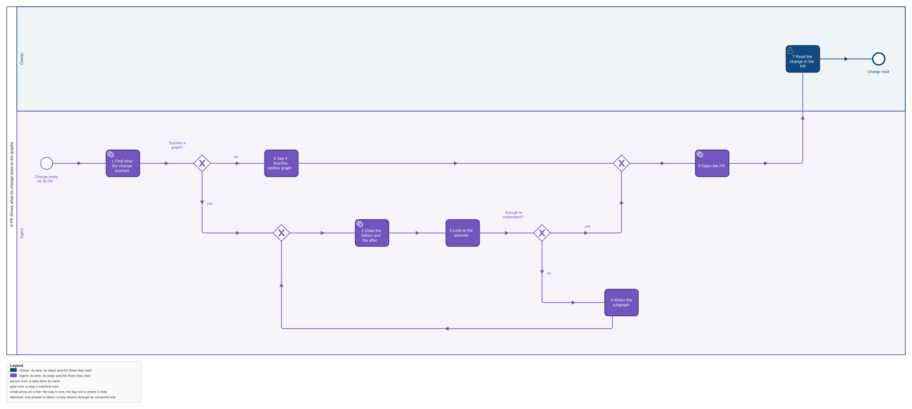
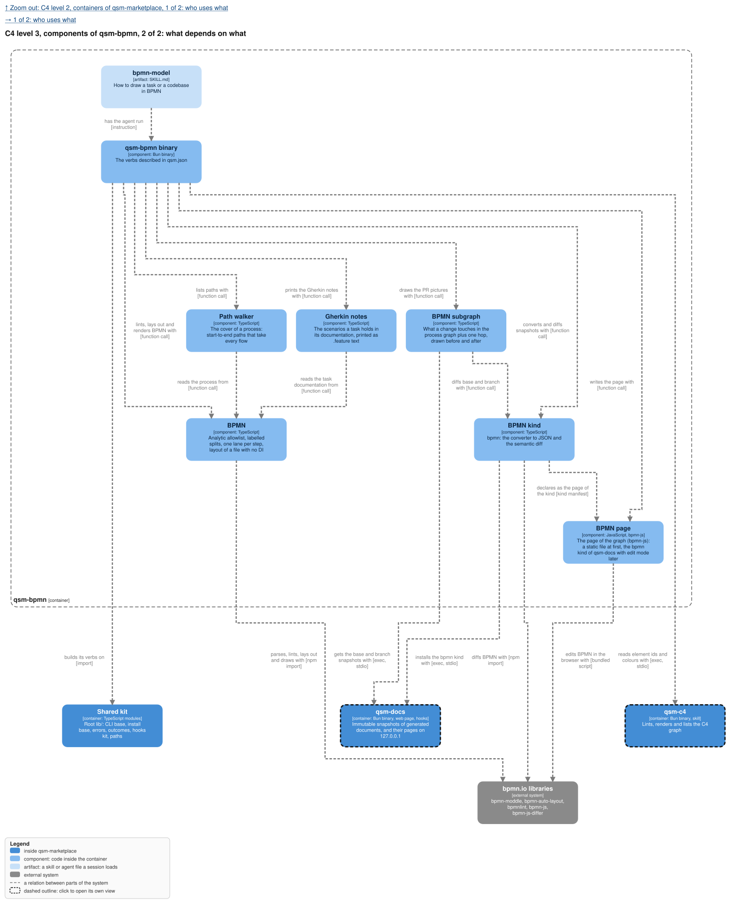
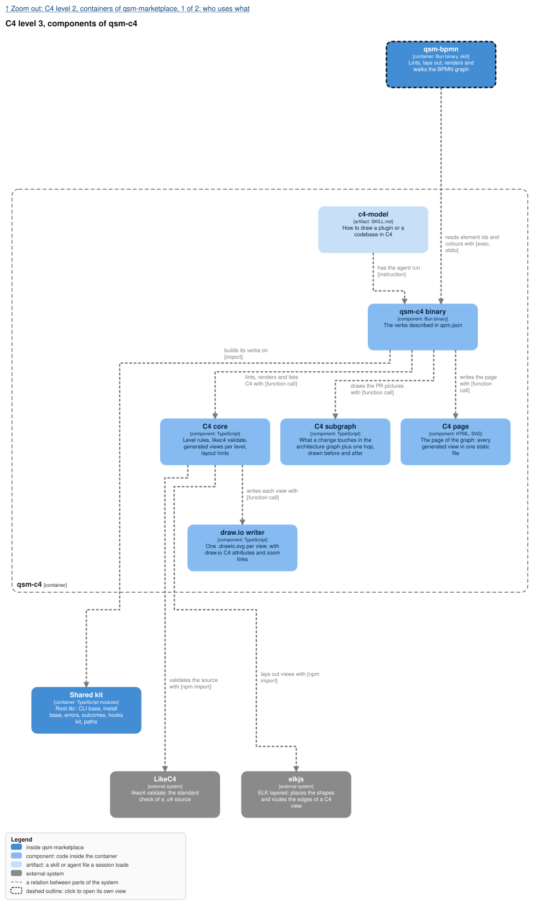

The Subgraph components of qsm-bpmn and qsm-c4 in `models/marketplace.c4` are this change, one per
graph.

## Why

A reviewer of a pull request must see whether the business logic or the architecture changed, and
a diff of BPMN XML or `.c4` text does not show it. Today a change carries pictures of its own
copies of the models, and nothing shows what it does to the project's one graph. This feature draws,
for each graph a change touches, the touched part before and after, added in green and removed in
red, and puts both into the pull request and the task, or says the change touches neither graph. It
is the fifth piece of epic qsm-vgw0.

## What

- **The touched subgraph**: what the branch adds, changes or removes in a graph against its base,
  plus one hop around it; the agent may widen it when understanding needs more.
- **A before and an after SVG** of that subgraph for each graph the change touches, drawn with the
  same renderer and layout hints as the committed pictures, added green, removed red.
- **The pull request carries them**, linked from its body and from the task; a change that touches
  neither graph says so in one line.
- **A change's `models/` holds these pictures**, so its proposal opens with what it does to the
  graphs.

## Not in this feature

Pictures of a whole graph in a PR, an animated or interactive diff, a review bot that asks for a
missing model update, a check that a change should have touched a graph.

## Decisions of the owner

1. **Pictures of the subgraph, both graphs, green and red** (2026-11-04, epic qsm-vgw0): "the PR
   carries static before and after pictures of that subgraph, added in green and removed in red,
   for both graphs, so a reviewer sees whether business logic or architecture changed."
2. **One hop, widened by the agent** (2026-11-04): "what it touches plus one hop, widened by the
   agent when understanding needs more".

## Critiques

- **Devil's advocate: a renamed element is both added and removed.** Fixed: the diff of
  `models-pages` names a rename as `renamed`, and the picture draws it once, red in the before and
  green in the after, with both names.
- **Devil's advocate: the before and after are laid out apart and the eye cannot match them.**
  Fixed: both are drawn from one layout of the union of the two subgraphs, so an element keeps its
  place, and an element only one side has leaves a gap in the other.
- **Devil's advocate: the base moves while the PR is open.** Fixed: the base is the merge base of
  the branch with its target, so new commits on the target do not show as the change's.
- **Future archaeologist: why the pictures live in the change and not only in the PR.** The feature
  schema's models artifact is the change's pictures; the PR links the committed files, so the
  pictures outlive the PR page.
- **Scope sniper: `--widen`.** The epic asks for it; kept as a list of element ids, nothing more.
- **Scope sniper: the task link.** The epic says "linked from the task and the PR"; one comment on
  the bound task, written by the same step.
