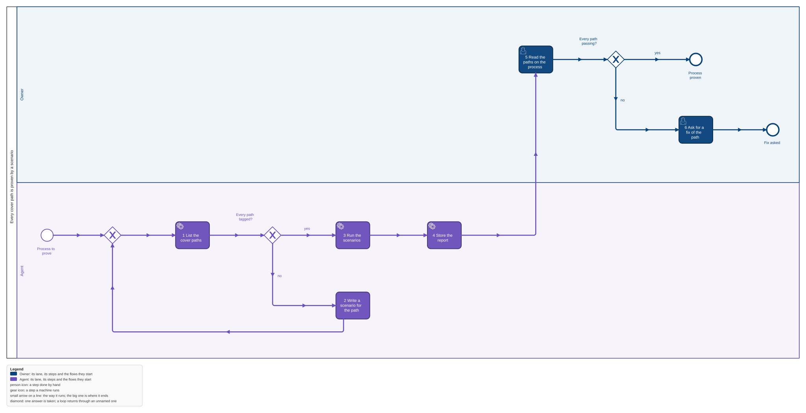
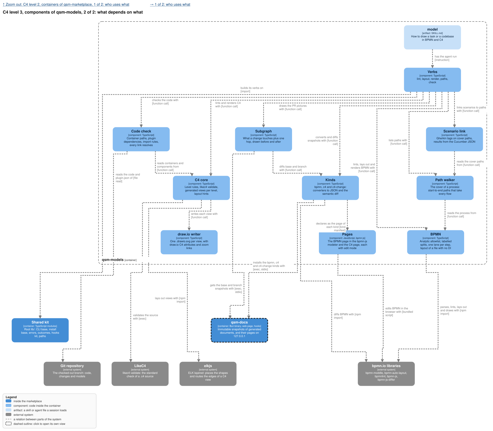

The Scenario link component of qsm-models in `../feature-flow/models/marketplace.c4` is this change.

## Why

The owner reads a process and wants to know which of its paths are proven and which are not. Today
a cover path is cited by a spec scenario, but nothing shows on the process whether a test runs it
or whether it last passed. This feature links a Gherkin scenario to its cover path by a tag and
shows each path's scenarios with their last result on the BPMN page, so a path nobody tests is
visible as uncovered. It is the fourth piece of epic qsm-vgw0.

## What

- **A scenario names its path by a tag**: `@p-9edef7` on a Gherkin scenario links it to that cover
  path. A scenario may carry several. Developers keep the scenarios.
- **The result comes from the feats Cucumber JSON report**, which carries each scenario's tags and
  each step's status; the agent stores it in qsm-docs after a run.
- **The BPMN page shows each path**: its scenarios with the last result, passed or failed, and a
  path that no scenario carries as uncovered.

## Not in this feature

Gherkin written by business people, a test runner of our own, JUnit reports (feats' JUnit carries
no tags), running the scenarios from the page.

## Decisions of the owner

1. **Developers keep the scenarios** (2026-11-04, epic qsm-vgw0): "Gherkin written by business
   people" is not this; "its result shows on the process instead". Research of the same day: "No
   organization I've encountered has business domain experts with the time and motivation to write
   executable requirements in Gherkin" (anecdotal).
2. **The feats Cucumber JSON** (2026-11-04): it carries scenario tags and step results; feats'
   JUnit does not carry tags.

## Critiques

- **Devil's advocate: a path id changes when its flows change, and every tag on it goes stale.**
  Fixed by `strict-visual-models`: `check` fails on a tag that names no path, so the change that
  renamed a flow re-tags its scenarios in the same commit.
- **Devil's advocate: the page shows the report of one machine.** The report is stored per branch;
  a run on another branch or a stale report shows old results. Fixed: the page names the report's
  time and branch beside each result.
- **Future archaeologist: why the report is a snapshot and not a file.** Design decision 1: the page
  reads only the store, so a report shows for another project's graph too, and the result of an
  earlier run is kept.
- **Scope sniper: a new kind `cucumber`.** The epic names three kinds; this adds a fourth. Open for
  the owner, with the alternative in design decision 1.
- **Scope sniper: highlighting a path on the diagram.** Kept as the one way to see which flows a
  path takes; without it a path id on a list is unreadable.
