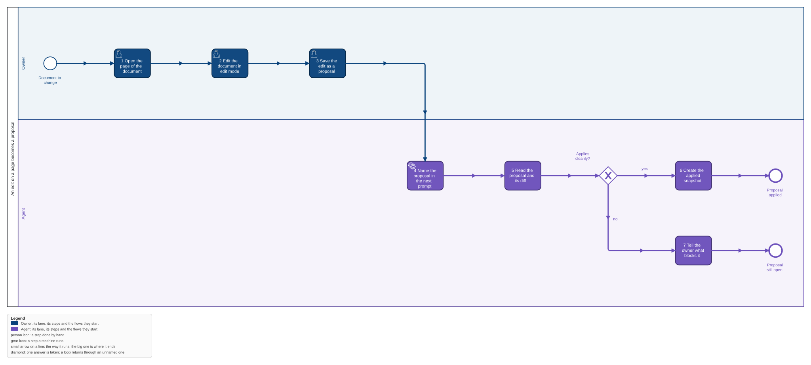
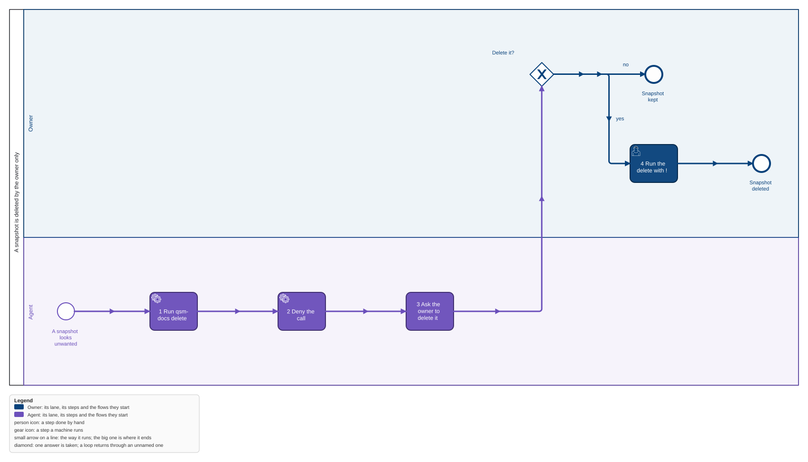
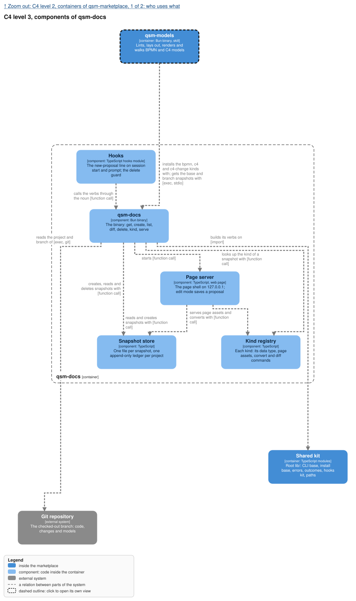

qsm-docs is one container of the marketplace's one C4 model, in
`../feature-flow/models/marketplace.c4`.

## Why

The owner wants to read a project's models in a browser and change them there, and the agent must
see each change and carry it into the source. Today a generated page is written once and thrown
away, an edit in a browser reaches nobody, and every plugin that wants a page builds its own server.
This feature adds the base every such page stands on: an immutable store of snapshots, one server
on 127.0.0.1 with one page shell, and a line to the agent when the owner saved a proposal. It is
the first piece of epic qsm-vgw0; `qsm-models` adds its kinds on top of it.

## What

- **A new plugin `qsm-docs`, one binary**: `get`, `create`, `list`, `diff`, `delete`, `kind add`,
  `kind list`, `kind remove` and `serve`. The CLI is the one contract; there is no MCP server.
- **Snapshots never change.** `create <kind> <file>` prints an id
  `<project>-<branch>-<timestamp>`, and `get <id>` returns exactly what was created. An edit is get,
  edit, create with a parent. The newest snapshot on a branch is that branch's current document.
- **Kinds come from other plugins.** A kind manifest names its data type, its page assets, the
  command that converts a snapshot to JSON and the command that diffs two. qsm-docs knows nothing
  of BPMN or C4. It has one kind of its own, `json`.
- **One page server** on 127.0.0.1: the page shell, the kind's page inside it, and edit mode, where
  saving creates a proposal: a new snapshot whose parent is the one the owner opened. No page
  requests anything outside 127.0.0.1.
- **The agent hears of a proposal.** At session start and on each prompt, one line names each new
  proposal of the session's project.
- **Only the owner deletes.** `delete` works from the owner's shell; a guard denies it to the agent,
  and a gate fails when a skill, agent or hook of the marketplace calls it.

## Not in this feature

The kinds `bpmn`, `c4` and `c4-change` and their pages (`models-pages`), the one graph per project
(`strict-visual-models`), the lens moved onto qsm-docs (the next piece), more than one user, a
cloud store, an update of a snapshot, a delete by an agent, an automatic apply, an MCP server.

## Decisions of the owner

1. **One graph, an immutable store, the CLI as the contract** (2026-11-04, epic qsm-vgw0): "Nothing
   is ever updated: an edit is get, edit in place, create." The id is
   `<project>-<branch>-<timestamp>`; snapshots are pulled by project, branch and time.
2. **Delete is the owner's** (2026-11-04): the owner decides deletion after some use; the agent is
   denied and the owner runs it with `!`.
3. **No MCP** (2026-11-04): "No MCP until a harness without a shell needs it, and then generated
   from the same `qsm.json`."
4. **Five changes in this order** (2026-11-04): qsm-docs, the revised strict-visual-models,
   models-pages, models-scenarios, models-pr-pictures, then a test-it task.

## Critiques

- **Devil's advocate: the store is a second source of truth beside git.** In repo mode the model
  is committed and also snapshotted, and the two can disagree. Fixed: the snapshot is a copy made
  from the committed file at apply, and the page of a repo-mode graph names the commit the snapshot
  came from (models-pages). The store is the truth only in local mode, where nothing is committed.
- **Devil's advocate: a timestamp id collides.** Two creates in one millisecond get one id. Fixed:
  `create` refuses an id that exists with `blocked`, so nothing is overwritten; the caller runs it
  again.
- **Devil's advocate: an open proposal is named at every session start.** A proposal the agent
  could not apply stays open until the owner deletes it, so it keeps coming back. Waived: that is
  the point, an edit the owner made must not be forgotten; the line is one line per project.
- **Future archaeologist: why a ledger and a file per snapshot.** Recorded in design decision 2:
  the file is the snapshot, the ledger is the order and the sha256 that prove it never changed.
- **Future archaeologist: why the converter runs at create.** Design decision 5: a snapshot no
  page can open must never enter the store, so `create` converts before it writes.
- **Scope sniper: `kind list` and `kind remove`.** The epic names a manifest another plugin
  installs, not these verbs. Kept: `kind remove` is how qsm-models' installer cleans before it
  writes (the clean-before-and-after rule), and `kind list` is how the owner sees what is installed.
- **Scope sniper: `list --open`.** Not in the epic's verb list. Kept: the hook needs the open
  proposals, and the logic belongs behind a verb, not in the hook.
- **Scope sniper: the built-in `json` kind.** Kept: without it the store, the server and edit mode
  cannot be proved before qsm-models exists, and the lens will be a JSON document.
- **Open: the schema has no tasks artifact.** The feature schema says a feature's tasks live on the
  board; the brief and spec-propose ask for a `tasks.md`. A `tasks.md` is written beside the
  artifacts as the build order; the owner decides whether it stays.
