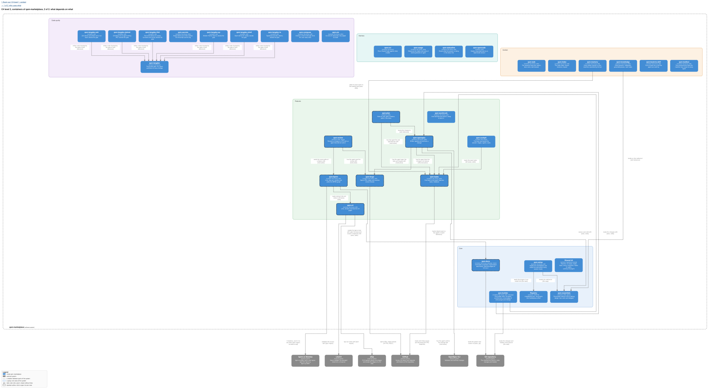

Where this sits in the whole flow: `../../../models/marketplace.build_task_process.svg` (the GitHub
lane). Feature #13, decoupled from #12 with #14 (`agent-identity`) and #15 (`status-action`).

## Feasibility

- **Can be done**: every requirement here. GitHub's API reads and writes issue types, sub-issues,
  labels and the board's fields through `gh` and GraphQL, measured on this repository.
- **Cannot**: create the board's views and built-in workflows; the API has no write for them, so
  `doctor` names each as `manual` and the owner sets it in the web UI.
- **Not here**: writes go out under the owner's login until #14, and a feature's Status between
  Todo and Done moves only by `plan` and `qa` until #15.
- **Size**: seven task pull requests, each under 400 counted lines (an estimate): the binary's
  skeleton with its outcomes and the repository and board resolution; the reads (`ready`, `list`,
  `show`, `note`); the creates and edits (`feature`, `add`, `edit`, `close`, the `change:` label);
  the flow table and `flow`; the moves with their guards (`claim`, `unclaim`, `review`, `human`,
  `reopen`, `plan`, `qa`); `feedback`; `doctor`, `setup` and the install.

## Why

Tasks move from a file in git to GitHub issues and the org board. An agent that drives the board
with raw `gh`, `jq` and GraphQL composes several calls per step and gets the flow wrong in a new way
each session. One tasks tool stays the agent's only door, so this feature gives the task port its
own binary, `qsm-tasks`, so the agent never composes a backend call.

## What

- **A binary `qsm-tasks`**, nineteen verbs, noun `$.tasks`: reads, create and edit, the task
  flow, `plan` and `qa` for a feature, `feedback`, `flow`, `doctor`, `setup`. A flag wherever
  GitHub already models the thing.
- **GitHub's defaults**: a feature is the issue type Feature, a task a sub-issue of type Task, one
  Status field, Priority P0 to P2, feedback a plain issue from a template, labelled `feedback`,
  `area:`, `kind:`, `from:`.
- **A change binds to its feature** by the label `change:<id>`.
- **The owner's merge of the feature pull request into main is the accept**; GitHub closes the
  feature and the board sets Done. No verb accepts.
- **`doctor` and `setup`** check and create what the API allows and name the rest.
- **Ghost mode**: the binary adds nothing of its own to what it posts.
- **Every write is the owner's own login**: issues, sub-issues, Status and comments. Only a pull
  request is opened as `qsmark-bot` (`agent-identity`, #14), by qsm-forge, not by this binary.

## Not in this feature

The Action that derives a feature's Status and closes what a merge into `feature/*` names
(`status-action`, #15), the `qsmark-bot` identity (`agent-identity`, #14), pull requests and review
threads (qsm-forge), git, GitLab, the skills that call the verbs and the move off `br`
(`tasks-on-github-issues`), views and built-in workflows (the API cannot create them), the QA
agent, the release train (`release-train`).

The owner sets up the existing board once, in the web UI: issue #3 gets the type Feature; the Status
options In Progress, In Review and Ready For Human Review are renamed In Dev, Agent Review and Human
Review; Ready For Human, Ready For Test, In Test and Blocked are added; the built-in workflow "Pull
request linked to issue" sets Agent Review; the field Epic stage and the issue type Epic are
deleted; the view Epics becomes Features (`type:Feature`) and Tasks filters
`-type:Feature -label:feedback`. `doctor` reports each leftover with its fix.

## Decisions of the owner

1. **`close` stays**: it finishes a task no merge closes, such as a decision.
2. **Feedback is a plain issue from a template, with labels**: what happened, where, how to
   reproduce it in the abstract, and how it should behave, with no personal or system detail and
   no suggested fix. The `from:` label stays on the public repository, because it says who noticed
   and nothing about the person.
3. **Priority is a field, P0 to P2**.
4. **GitHub's defaults**: features instead of epics, tasks under them, and QA tests the feature,
   because a second hierarchy would fight the GitHub ecosystem.
5. **Each kind uses its own part of one Status**: a task needs a review and no QA, a feature needs
   its test and no review.
6. **One door, nothing duplicated**: nothing GitHub already does is built again, and one tasks
   tool is the agent's only way to the board.
7. **The feature branch and the accept**: task pull requests target `feature/<n>`, the Action
   closes what they name, and the owner's merge of the feature pull request into main is the
   accept; the spec binds to the feature; tasks are created at the split, not at planning.
8. **Split into three features**: the binary (#13), the bot (#14) and the Action (#15), each
   working alone, in that order.
9. **`claim` assigns the caller**, as the spec says; the owner stays the assignee of what nobody
   claims.
10. **The plan was approved from one page**: a picture of the task and feature lifecycles, the
    verbs in four groups and the seven task pull requests.
11. **The board holds the work, not the pull requests**: a pull request that closes an issue is
    reached from that issue, so each piece of work is one card whose Status tells where it is.
    Only a side pull request, which closes no issue, is a card of its own. The Auto-add workflow
    adds issues only, and the agent adds a side pull request when it opens one.
