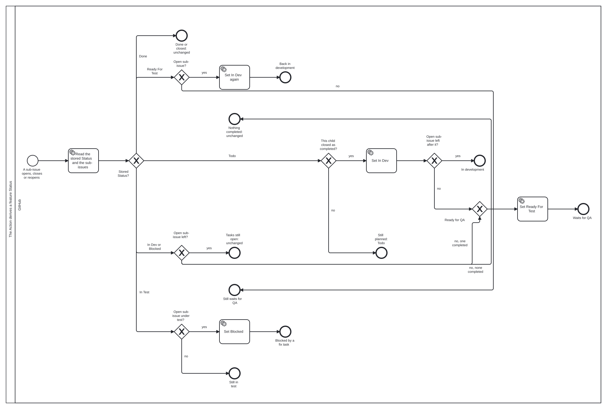

Where this sits in the whole flow: `../feature-flow/models/flow.svg` (the GitHub lane).

## Why

Tasks move from a file in git to GitHub issues and the org board. An agent that drives the board
with raw `gh`, `jq` and GraphQL composes several calls per step and gets the flow wrong in a new way
each session. The owner: "i still want my one tasks tool". This feature gives the task port its
own binary, `qsm-tasks`, so the agent never composes a backend call, and an Action that keeps a
feature's Status true to its tasks.

## What

- **A binary `qsm-tasks`**, nineteen verbs, noun `$.tasks`: reads, create and edit, the task
  flow, `plan` and `qa` for a feature, `feedback`, `flow`, `doctor`, `setup`. A flag wherever
  GitHub already models the thing.
- **GitHub's defaults**: a feature is the issue type Feature, a task a sub-issue of type Task, one
  Status field, Priority P0 to P2, Feedback its own issue type with `area:`, `kind:`, `from:`.
- **A change binds to its feature** by the label `change:<id>`.
- **One Action, `.github/workflows/qsm-tasks.yml`**: it derives a feature's Status (the model
  above) and closes the issues a pull request names when it merges into `feature/*`, which GitHub
  does itself only for the default branch.
- **The owner's merge of the feature pull request into main is the accept**; GitHub closes the
  feature and the board sets Done. No verb accepts.
- **`doctor` and `setup`** check and create what the API allows and name the rest.
- **Ghost mode**: the binary adds nothing of its own to what it posts.

## Not in this feature

Pull requests and review threads (qsm-forge), git, GitLab, the skills that call the verbs and the
move off `br` (`tasks-on-github-issues`), views and built-in workflows (the API cannot create
them), the QA agent, the release train (`release-train`).

The owner sets up the existing board once, in the web UI: issue #3 gets the type Feature; the
Status options In Progress, In Review and Ready For Human Review are renamed In Dev, Agent Review
and Human Review; Ready For Test, In Test and Blocked are added; the built-in workflow "Pull
request linked to issue" sets Agent Review; the field Epic stage and the issue type Epic are
deleted; the view Epics becomes Features (`type:Feature`) and Tasks filters `-type:Feature
-type:Feedback`. `doctor` reports each leftover with its fix.

## Decisions of the owner

1. **`close` stays** (2026-10-29): it finishes a task no merge closes, such as a decision.
2. **Feedback is an issue type with labels** (2026-10-30): "i want area, kind, from/who noticed,
   some basic log of things that lead to that, WITHOUT ANY PERSONAL OR SYSTEM INFO, just abstract
   stuff, and than the rest. Ideally no suggested fix, but how i want it to behave." The `from:`
   label on a public repository: "its an AI marketplace, im okay with keeping this there."
3. **Priority is a field, P0 to P2** (2026-10-30).
4. **GitHub's defaults** (2026-10-30): "Cannot we use features instead of epics, than stack tasks
   under them, and than qa test the feature instead of the epic? So we dont overengineer and
   destroy the github ecosystem?"
5. **Each kind uses its own part of one Status** (2026-10-30): "tasku staci review, nepotrebuje
   qa, a feature zase nepotrebuje review, ma test."
6. **One door, nothing duplicated** (2026-10-30): "i dont want to duplicate anything that github
   already has a way to do normally" and "i still want my one tasks tool".
7. **The feature branch and the accept** (2026-11-01): task pull requests target `feature/<n>`,
   the Action closes what they name, and the owner's merge of the feature pull request into main
   is the accept; the spec binds to the feature; tasks are created at the split, not at planning.
