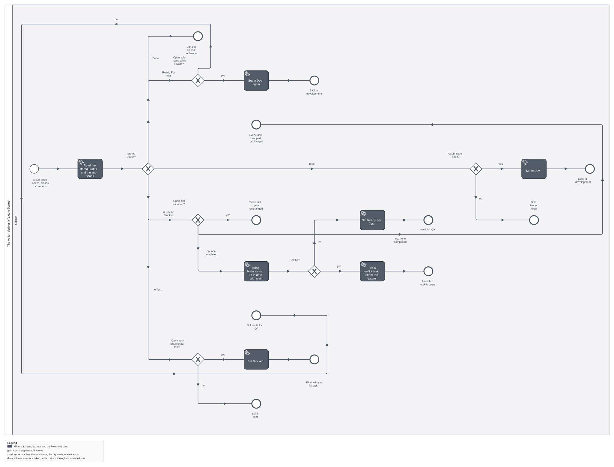

Where this sits in the whole flow: `../../../models/marketplace.build_task_process.svg` (the GitHub
lane). Feature #15, decoupled from #12; planned on its own after #13 (`qsm-tasks-cli`) and #14
(`agent-identity`).

## Why

Nothing moves a feature between Todo and Done: the board's built-in workflows know only "added"
and "closed". And GitHub closes the issues a pull request names only when it merges into the
default branch, not into `feature/<n>`, so a merged task stays open.

## What

- **One Action, `.github/workflows/qsm-tasks.yml`**: it derives a feature's Status (the model
  above): In Dev when the split adds the first task; when the last task closes it brings
  `feature/<n>` up to date with main and sets Ready For Test, or files a conflict task.
- **It closes the issues a pull request names** when it merges into `feature/*`.
- **`qsm-tasks doctor`** checks the Action's file and that its names match the flow table.

## Not in this feature

The verbs (#13), the bot identity (#14), the QA agent.
