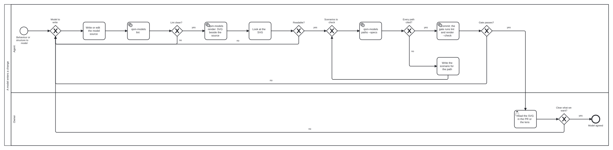
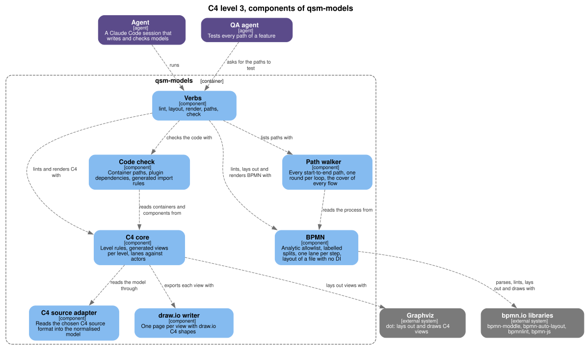

Context and containers: `models/qsm-models.context.svg`, `models/qsm-models.containers.svg`;
all three views open in draw.io from `models/qsm-models.drawio`.

## Why

The owner wants every side to see the same thing: "vsude strict defined theorem visual models, tak
aby bylo jasne na vsechny strany really co chceme". Today nothing in the marketplace draws a
process, nothing checks a diagram, and a spec is text only. A model an agent can write but nobody
checks is a picture that drifts; a strict one is a contract the owner reads, QA tests, and the
code is checked against. This feature adds the one tool that makes BPMN and C4 strict.

## What

- **A new plugin `qsm-models`, one binary**: `lint`, `layout`, `render`, `paths`, `check`.
- **BPMN is strict**: the BPMN 2.0.2 Analytic sub-class only, every split's answers labelled,
  every step in one lane, every lane an actor of the C4 model, every path ends.
- **C4 is strict**: four kinds (person, system, container, component), each at its level, every
  relation says what it does, every internal container names its code; views are generated per
  level, so no view mixes levels.
- **Rendered and committed**: an SVG beside each source, a draw.io file of the C4 views; a
  stale SVG fails the commit.
- **Paths are QA's scenarios**: `paths` lists the fewest start-to-end paths that take every flow,
  each with a stable id; every path is cited by a spec scenario.
- **Checked against the code**: container paths, plugin dependencies and generated import rules.
- **Seen in the lens**: a Models section per plugin, the features in flight with their SVGs, and a
  BPMN viewer.

## Not in this feature

Executing BPMN, BPMN Common Executable elements, round-trip of draw.io geometry, a C4 deployment
or dynamic view, the QA agent that runs the paths (`qa-agent`).

## Decisions of the owner

1. **BPMN as `.bpmn`, edited in bpmn.io** (2026-11-01): settled.
2. **C4 in draw.io** (2026-11-01): the owner chose draw.io (`.drawio.svg`) before the research
   found that LikeC4 exports draw.io one way only. The source format is open: design decision 4
   holds the options, the measurements and the recommendation. The rest of this feature holds
   for either.
