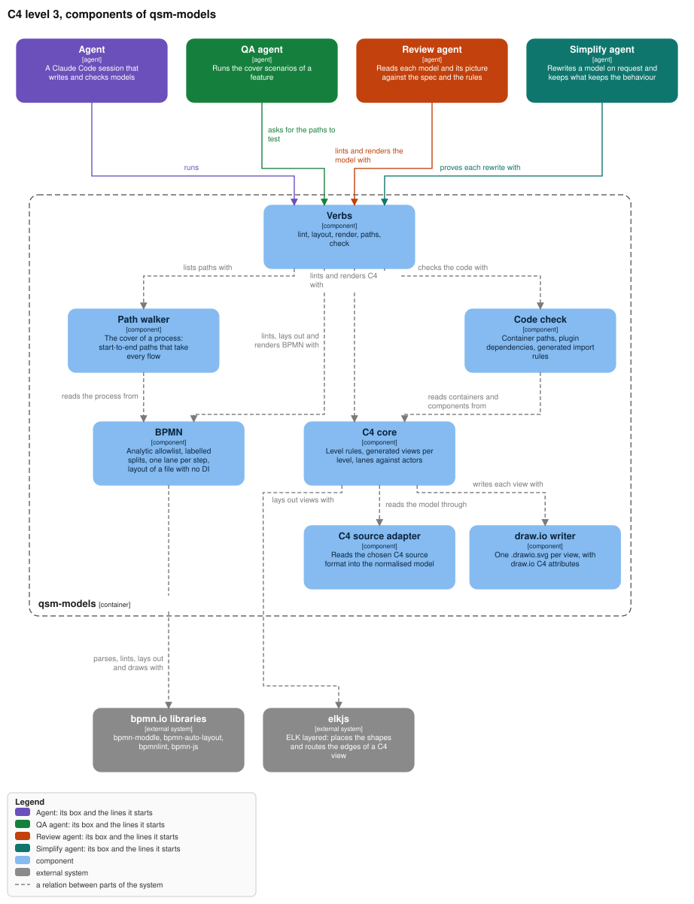
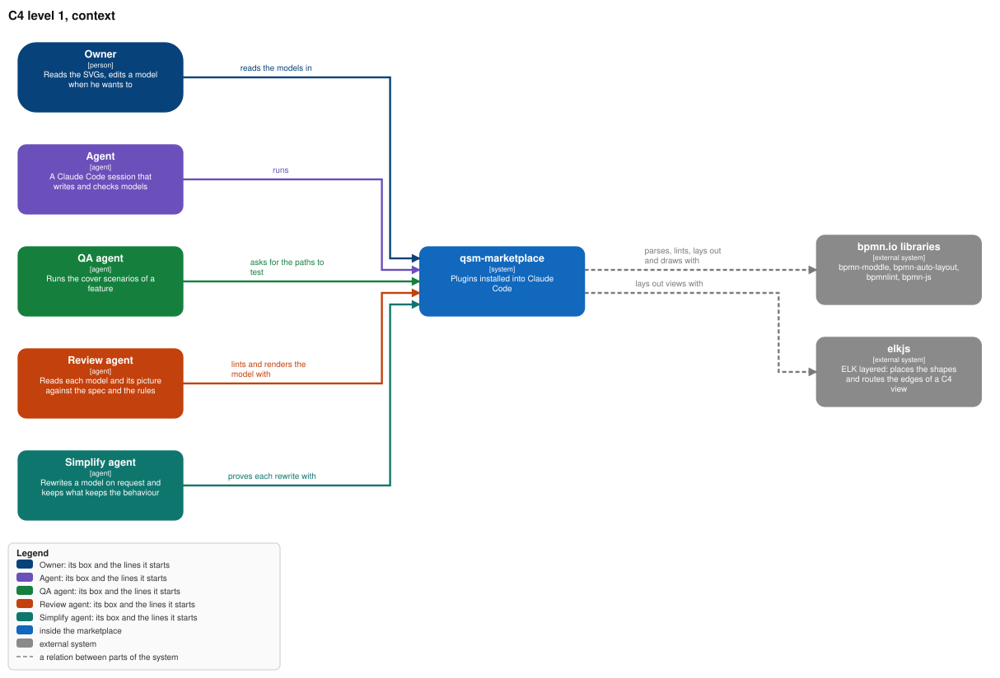

Each `.drawio.svg` opens editable in draw.io; the containers view is
`models/qsm-models.containers.drawio.svg`.

## Why

The owner wants every side to see the same thing: "vsude strict defined theorem visual models, tak
aby bylo jasne na vsechny strany really co chceme". Today nothing in the marketplace draws a
process, nothing checks a diagram, and a spec is text only. A model an agent can write but nobody
checks is a picture that drifts; a strict one is a contract the owner reads, QA tests, and the
code is checked against. This feature adds the one tool that makes BPMN and C4 strict.

## What

- **A new plugin `qsm-models`, one binary**: `lint`, `layout`, `render`, `paths`, `check`.
- **BPMN is strict**: the BPMN 2.0.2 Analytic sub-class only, every split's answers labelled,
  every step in one lane, every lane an actor of the C4 model, no step without a way to an end.
- **C4 is strict**: four kinds (person, system, container, component), each at its level, every
  relation says what it does, every internal container names its code; views are generated per
  level, so no view mixes levels.
- **Rendered and committed**: an SVG beside each BPMN, a `.drawio.svg` per C4 level that GitHub
  shows and draw.io opens; a stale picture fails the commit.
- **The cover becomes scenarios**: `paths` lists the cover of a process, a set of start-to-end
  paths that together take every flow, each with a stable id; every cover path has a spec
  scenario, and QA runs the scenarios.
- **Checked against the code** (to be proved first, see the design's Verify): container
  dependencies and generated import rules.
- **Seen in the lens**: a Models section per plugin, the features in flight with their SVGs, and a
  BPMN viewer.

## Not in this feature

Executing BPMN, BPMN Common Executable elements, round-trip of draw.io geometry, a C4 deployment
or dynamic view, the QA agent that runs the paths (`qa-agent`).

## Decisions of the owner

1. **BPMN as `.bpmn`, edited in bpmn.io** (2026-11-01): settled.
2. **C4 as `.drawio.svg`** (2026-11-01): one file, an SVG with the draw.io diagram inside, that
   GitHub shows and draw.io opens. Built that way. Which text an agent writes the C4 model in is
   open: design decision 5 and open decision 1.
