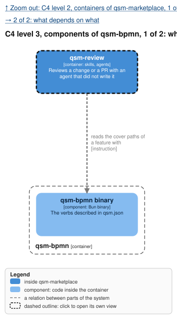
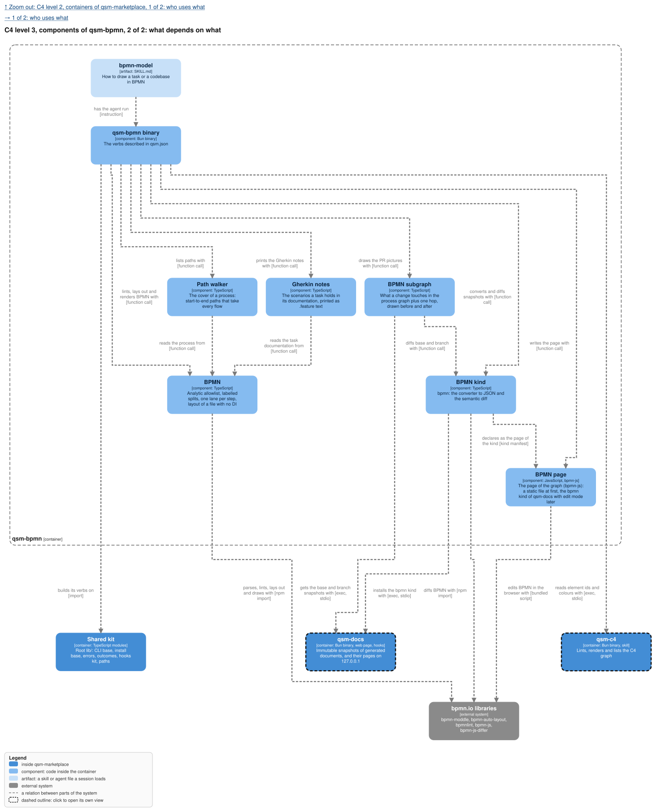
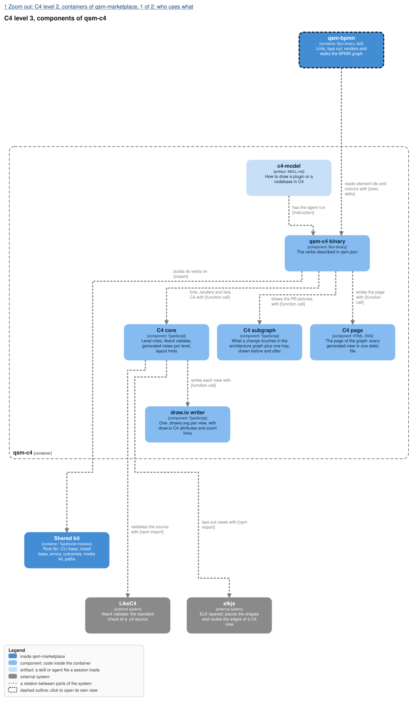

The pictures are the ones `render` writes beside the one graph of each kind under the root
`models/`; each `.drawio.svg` opens editable in draw.io. The C4 views draw the two plugins
qsm-bpmn and qsm-c4, and the gate process the gate of decision 25 of the design: the lint and the
reviewer before an edit is written into the graph.

## Why

The owner wants every side to see the same thing: "vsude strict defined theorem visual models, tak
aby bylo jasne na vsechny strany really co chceme". Before this change nothing in the marketplace
drew a process, nothing checked a diagram, and a spec was text only. A model an agent can write but
nobody checks is a picture that drifts; a strict one is a contract the owner reads and QA tests.
This feature adds two tools, one that makes BPMN strict and one that makes C4 strict, each working
alone, and one graph of each per project that every change works on.

## What

- **Two plugins, `qsm-bpmn` and `qsm-c4`, each one binary**, its verbs the ones described in its
  own `qsm.json`, its own skill (`bpmn-model`, `c4-model`), its own `model-reviewer`, its own
  page, its own checks.
  The first build shipped both as one plugin, `qsm-models`; the split moves that code.
- **One graph per kind per project**: `models/<project>.bpmn` and `models/<project>.c4`, committed,
  never a copy per change or per plugin. The marketplace's existing models migrated once into its
  one graph.
- **The standards check their own sources**: bpmnlint with its recommended rules and our Method and
  Style rules, and `likec4 validate`, before our own rules.
- **BPMN is pure business**: every step in one lane, a lane a business role that needs no C4
  element, the Analytic sub-class only, every split's answers labelled, no step without a way to an
  end, no file or command in a name.
- **C4 is strict**: four kinds, each at its level, every relation says what it does, every internal
  container names its code; level 3 is optional; views are generated per level.
- **One optional link, not qsm-specific**: a BPMN element may carry `c4:element`, the id of a C4
  element, read only through `qsm-c4 elements`. A BPMN graph with no id needs no qsm-c4; with an
  id and no qsm-c4, it fails `missing`. A lane linked to an actor takes the actor's colour.
- **The checks live in the generators**: every verb that writes or converts a graph runs the
  plugin's full lint first and writes nothing on a finding; an edit written into the model file
  also needs `model-reviewer`'s pass, which the skill enforces because a binary cannot run an
  agent; the PR picture needs no agent.
- **The first build shows the models**: `qsm-bpmn pages` and `qsm-c4 pages` each write one
  self-contained HTML, into `.qsm/bpmn/` and `.qsm/c4/`, a BPMN page with drill-down and a C4
  page with levels.
- **An applied move survives**: BPMN keeps its own geometry, a C4 element carries layout hints.
- **Rendered and committed**: an SVG per process, a `.drawio.svg` per C4 view, beside the graph;
  `render --check` names a stale picture, and `render` refuses a picture whose layout measures got
  worse unless the owner types `--accept <measure>`.
- **The cover becomes scenarios**: `qsm-bpmn paths` lists the cover of each process, with stable
  ids; every cover path has a spec scenario, and QA runs the scenarios.
- **Drawn to rules, not by hand**, with a skill and a reviewer per plugin, and a simplifier in
  qsm-bpmn on request.

## Not in this feature

Executing BPMN, BPMN Common Executable elements, round-trip of draw.io geometry, a C4 deployment or
dynamic view, the QA agent that runs the paths (`qa-agent`), the editable pages of the graphs, their
history in the qsm-docs store and the kinds behind them (`models-pages`, which also holds the
Gherkin notes), any link between Gherkin and tests, the before and after pictures of a PR
(`models-pr-pictures`), and the lens showing models. Removed by the owner on 2026-11-06: the check
of C4 against the code, decision links (`qsm:decision`, C4 `decision`, `design:` and `commit:`),
the verified commit, the check for model files outside `models/`, links into other projects, the
commit gate in qsm-langdev, the spec-propose and spec-archive change in qsm-openspec, and, decided
with this revision, local mode.

## Decisions of the owner

1. **BPMN as `.bpmn`, edited in bpmn.io** (2026-11-01): settled.
2. **C4 as `.drawio.svg`** (2026-11-01): one file, an SVG with the draw.io diagram inside, that
   GitHub shows and draw.io opens. Built that way. The source an agent writes is LikeC4 `.c4`
   (decision 6).
3. **Strict layout, more colour, clear layers** (2026-11-01): "aby ty graph items byly bliz u sebe,
   a mely lepsi structure", "vice barvicek, a vice layer separation", and rules and a workflow "jak
   udelat cokoliv do BPMN a do C4, od mensiho tasku, do celeho codebase", reviewed after creation,
   with an optional strong agent that "bude chodit po tom grafu a bude se snazit simplifikovat ten
   model".
4. **Colour by actor, the GitHub Action as a lane, at most 10 activities a level** (2026-11-01):
   the owner took the three recommendations where the sources disagree (design decision 13).
5. **One activity, one action** (2026-11-01), the owner's own words on a merged step: "ta jedna
   aktivita dela dve akce, a ma delat jednu, protoze je to jedna aktivita".
6. **One graph per kind per project, standard sources, pure-business BPMN** (2026-11-04, epic
   qsm-vgw0): "One graph per kind per project, never a copy per change or per plugin." BPMN 2.0 XML
   and LikeC4 `.c4`, validated by bpmnlint and `likec4 validate`; the BPMN graph "knows nothing
   about code"; links are optional, and "every link must resolve or the gate fails". This revised
   the change: the lane-is-a-C4-actor rule, the model per change merged at archive, the lens's
   model view and the open C4 format are gone.
7. **A first build for visualization, static pages and no store** (2026-11-05): the tools are an MVP
   for visualization, "absolute bare bones: generate, show proper models, with validation rules and
   proper modeling". It validated, rendered and wrote one HTML per graph kind into
   `<repo>/.qsm/models/`; the pages request nothing outside the file.
8. **No link between Gherkin and tests** (2026-11-05): the owner writes Gherkin scenarios in a
   task's `documentation` on its details page; no tags, no results, no generation. `models-pages`
   holds the notes.
9. **Two self-contained tools, one neutral link, checks in the generators** (2026-11-06): "Chci 2
   separate tools, ktere mi zobrazi grafy modelu podle nasich rules, super strict checks, easy to
   work with for agents, default self history, never delete only add. BPMN will have optional
   gherkin features per step. Everything is multilayers. Currently in MVP build currently for one
   project - qsm marketplace - only. The two tools are selfcontained, only with some options for
   connections between them using c4 ids or something in the bpmn, that is not qsm tool specific."
   On the checks: "Ten check co je v langdev ma byt v tech generatorech samotnych, kdyz to chcec
   vygenerovat in or out, or for the web, musi to projit vsema kontrolama, vcetne agents, teda web
   nemusi agents, protoze to se generuje read only z toho co mame ted locally." The history is the
   qsm-docs store (create, get, and delete only by the owner, never an edit), every local edit on
   a page is a proposal, and the PR picture is show-only; those belong to `models-pages` and
   `models-pr-pictures`, which the owner revises next. This revision split the plugin, kept one
   link, moved the checks and removed what the "Not in this feature" section lists. It invalidated
   design decisions 1, 9, 17 and 18, Verify 1, the qsm-langdev and qsm-openspec capabilities, and
   tasks lines 2, 7, 9, 10 and 13. Choices the words left open were decided on 2026-11-06 by the
   main agent as craft, each with its options in the design:
   - local mode removed (design 7);
   - the six palette colours in root `lib/palette.ts` (design 13), and what both plugins do the
     same way in root `lib/` (design 23);
   - a `model-reviewer` in each plugin, `model-simplifier` in qsm-bpmn only, the skills
     `bpmn-model` and `c4-model` (design 16);
   - the attribute `c4:element` under `https://c4model.com` unless tasks line 17 finds a published
     convention; the door `qsm-c4 elements --json`; qsm-c4 an optional reach, no `plugin.json`
     dependency of qsm-bpmn (design 24);
   - no `check` verb, folded into each plugin's lint; `render` refuses a worse layout and only the
     owner types `--accept <measure>` (design 25);
   - the pages in `.qsm/bpmn/` and `.qsm/c4/` (design 22).

## Critiques

The passes of the revision of 2026-11-06. The passes of the earlier revisions found the merge
conflict of one XML file (waived: one maintainer, design decision 7 reopens when it costs more),
the compiled renderer's 100 MB (accepted over Chrome), the bpmn-js internals the render stubs use
(pinned; a break fails loud), and the loops that share one routing channel (accepted until the open
layout decision); they still hold, the split halves the binary sizes, and the rest were fixed.

- **Devil's advocate: the "in" gate is a sentence in a skill, so a skipped review leaves no
  trace.** Nothing mechanical stops an agent that writes the file and commits without the
  reviewer. Waived with its reason: the owner placed the agents in the gate and a binary cannot
  start one; the spec says so in "An edit reaches the graph file only after the reviewer", and the
  lint half still holds in every verb. Reopens when a commit lands a graph the reviewer never read.
- **Devil's advocate: the lane colour is written at `layout` time, so a C4 colour changed later
  leaves a lane stale.** Fixed: "Every C4 id resolves or lint fails" also refuses a linked lane
  whose colour is not its actor's, so the next `render` stops on it.
- **Devil's advocate: dropping the commit gate lets a stale picture reach main.** Waived: the owner
  moved the checks into the generators, `render --check` still names a stale picture, and the skill
  runs it before a commit; a picture rendered by hand from a graph lint refuses is impossible,
  because `render` lints first.
- **Devil's advocate: `https://c4model.com` is a domain we do not own.** Waived with its reason:
  an XML namespace is a name, never fetched, and the owner asked for a name that is not ours; the
  cost is written in design decision 24, and line 17 searches for a published convention first.
- **Future archaeologist: why two plugins carry an agent of the same name.** Design decision 16:
  each plugin works alone, so each reviews alone; the prefix (`qsm-bpmn:model-reviewer`) tells them
  apart, and the simplifier lives where `paths --compare` lives.
- **Future archaeologist: why removed tasks lines and design decisions keep their numbers.** The
  numbers are cited across the three model changes and the commits; a removed item says "removed"
  with its date and leaves its number, so a citation never points at a different item.
- **Future archaeologist: why qsm-bpmn calls a binary for data in a file beside it.** AGENTS.md: a
  plug-in reaches another only through its contract, never its files; design decision 24.
- **Scope sniper: the new verb `qsm-c4 elements`.** Kept: the owner's colour rule and link check
  need the C4 graph's ids and colours, and no verb printed them; it is one verb over the parse
  `lint` already does. Rejected: reading the `.c4` file from qsm-bpmn.
- **Scope sniper: `render --accept`.** A flag the owner did not name. Kept: the commit message
  that let a worse measure through went with the commit gate, and without a way past it the
  measure blocks every honest growth. The skill leaves the flag to the owner, so an agent cannot
  wave its own worse picture through (design decision 25).
- **Scope sniper: tasks line 23, the gate process redrawn.** Kept: this change's own pictures show
  a commit gate the change no longer has, and the scenarios cite its paths.
- **Scope sniper: the subgraph requirements of `models-pr-pictures` written once per plugin.**
  Kept to the minimum the split needs: one verb per plugin, its scope unchanged, a scenario for
  each half; the owner revises that change next.
