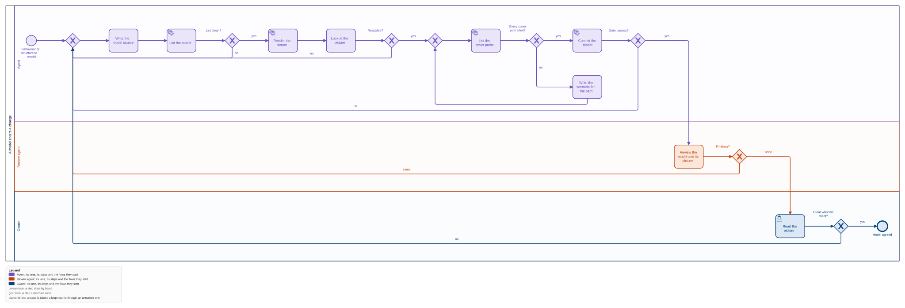
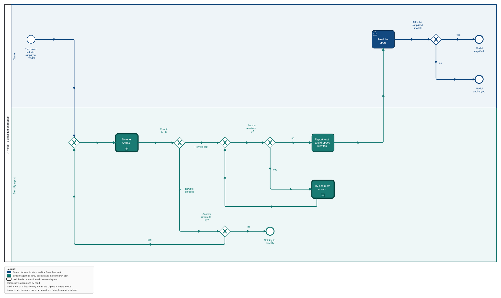
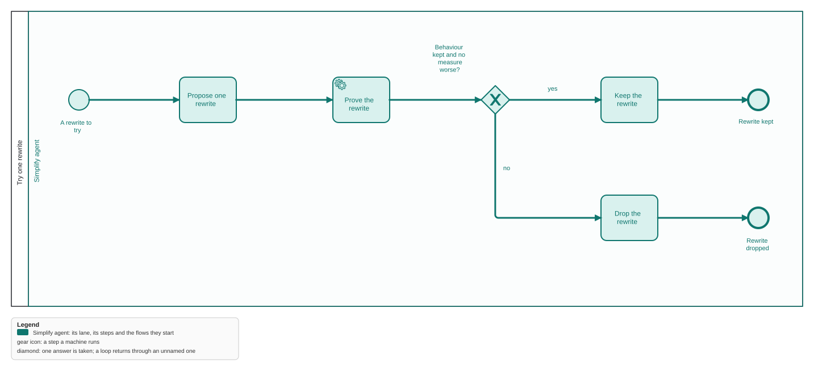
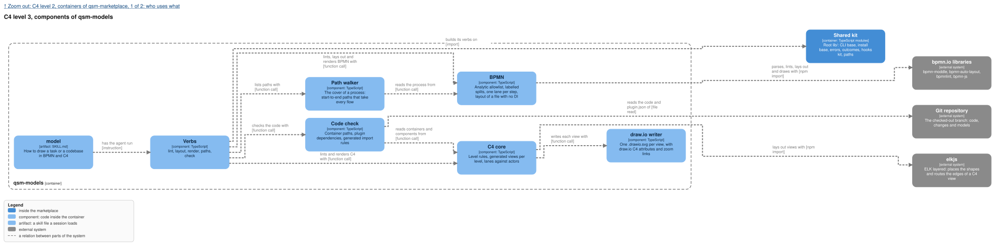

qsm-models is one container of the marketplace's one C4 model; its context and container views are
`../feature-flow/models/marketplace.context.drawio.svg` and the two `containers` views. Each
`.drawio.svg` opens editable in draw.io.

## Why

The owner wants every side to see the same thing: "vsude strict defined theorem visual models, tak
aby bylo jasne na vsechny strany really co chceme". Today nothing in the marketplace draws a
process, nothing checks a diagram, and a spec is text only. A model an agent can write but nobody
checks is a picture that drifts; a strict one is a contract the owner reads, QA tests, and the
code is checked against. This feature adds the one tool that makes BPMN and C4 strict.

## What

- **A new plugin `qsm-models`, one binary**: `lint`, `layout`, `render`, `paths`, `check`.
- **BPMN is strict**: the BPMN 2.0.2 Analytic sub-class only, every split's answers labelled,
  every step in one lane, every lane an actor of the C4 model, no step without a way to an end.
- **C4 is strict**: four kinds (person, system, container, component), each at its level, every
  relation says what it does, every internal container names its code; views are generated per
  level, so no view mixes levels.
- **Rendered and committed**: an SVG beside each BPMN, a `.drawio.svg` per C4 level that GitHub
  shows and draw.io opens; a stale picture fails the commit.
- **The cover becomes scenarios**: `paths` lists the cover of a process, a set of start-to-end
  paths that together take every flow, each with a stable id; every cover path has a spec
  scenario, and QA runs the scenarios.
- **Checked against the code** (to be proved first, see the design's Verify): container
  dependencies and generated import rules.
- **Seen in the lens**: a Models section per plugin, the features in flight with their SVGs, and a
  BPMN viewer.
- **Drawn to rules, not by hand**: BPMN follows Bruce Silver's Method and Style (at most 10
  activities a level, one action per activity, loops back through a merge gateway, named end
  states); C4 views come in tiers (actors, the system with its groups, external systems) and split
  by question when crowded. One actor has one colour in every picture, and every picture has a
  legend. The agent changes the model, an engine places the shapes, and measures (crossings, edge
  length, bends, lane jumps, area) refuse a picture that got worse.
- **A way to make a model, and a way to simplify it**: a skill `model` takes any piece of work, a
  task up to the whole marketplace, to its views; a reviewer agent reads every picture; a
  simplifier agent, run on request, rewrites the model and keeps only what `paths --compare`
  proves keeps the behaviour.

## Not in this feature

Executing BPMN, BPMN Common Executable elements, round-trip of draw.io geometry, a C4 deployment
or dynamic view, the QA agent that runs the paths (`qa-agent`).

## Decisions of the owner

1. **BPMN as `.bpmn`, edited in bpmn.io** (2026-11-01): settled.
2. **C4 as `.drawio.svg`** (2026-11-01): one file, an SVG with the draw.io diagram inside, that
   GitHub shows and draw.io opens. Built that way. Which text an agent writes the C4 model in is
   open: design decision 5 and open decision 1.
3. **Strict layout, more colour, clear layers** (2026-11-01): "aby ty graph items byly bliz u sebe,
   a mely lepsi structure", "vice barvicek, a vice layer separation", and rules and a workflow "jak
   udelat cokoliv do BPMN a do C4, od mensiho tasku, do celeho codebase", reviewed after creation,
   with an optional strong agent that "bude chodit po tom grafu a bude se snazit simplifikovat ten
   model".
4. **Colour by actor, the GitHub Action as a lane, at most 10 activities a level** (2026-11-01):
   the owner took the three recommendations where the sources disagree (design decision 13).
5. **One activity, one action** (2026-11-01), the owner's own words on a merged step: "ta jedna
   aktivita dela dve akce, a ma delat jednu, protoze je to jedna aktivita".
