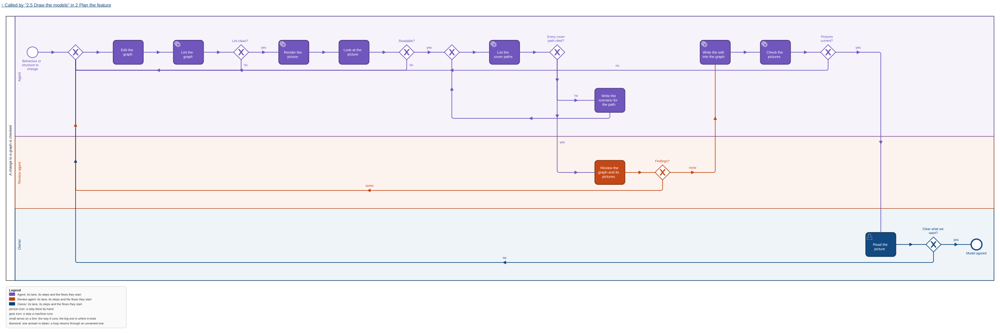
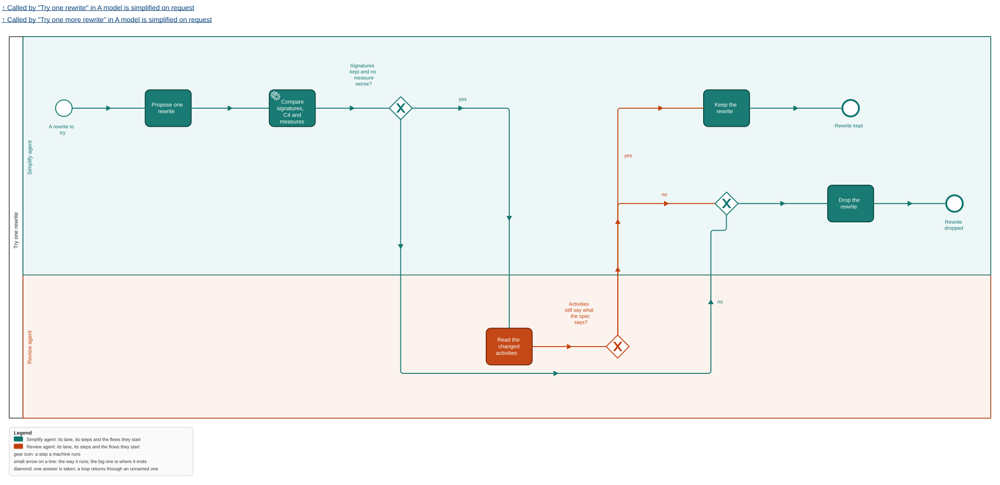
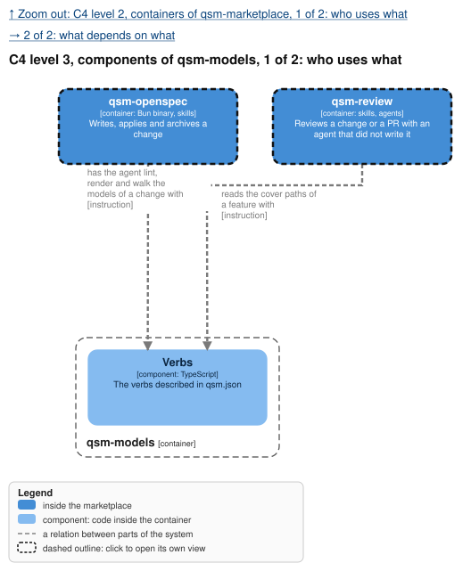
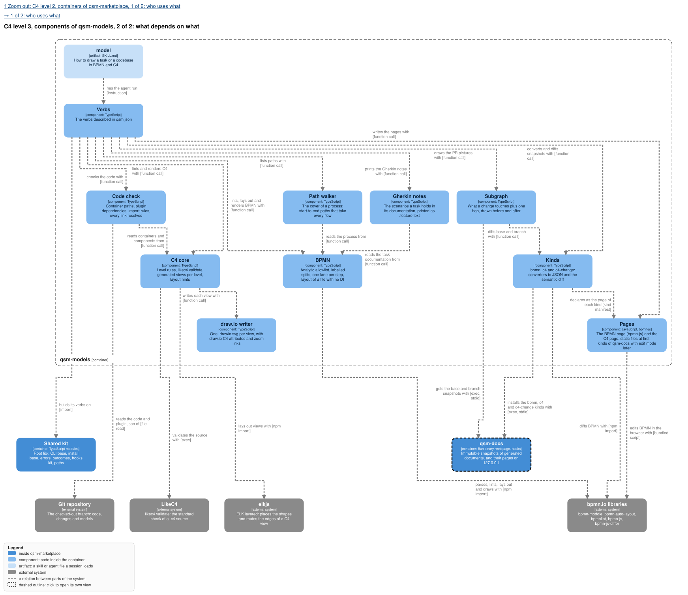

qsm-models is one container of the marketplace's one C4 model; its context and container views are
`../../../models/marketplace.context.drawio.svg` and the two `containers` views. Each `.drawio.svg`
opens editable in draw.io. The pictures are the ones `render` writes beside the one graph under the
root `models/`.

## Why

The owner wants every side to see the same thing: "vsude strict defined theorem visual models, tak
aby bylo jasne na vsechny strany really co chceme". Today nothing in the marketplace draws a
process, nothing checks a diagram, and a spec is text only. A model an agent can write but nobody
checks is a picture that drifts; a strict one is a contract the owner reads, QA tests, and the
code is checked against. This feature adds the one tool that makes BPMN and C4 strict, and one
graph of each per project that every change works on.

## What

- **A new plugin `qsm-models`, one binary**, its verbs the ones described in `qsm.json`.
- **One graph per kind per project**: `models/<project>.bpmn` and `models/<project>.c4`, never a
  copy per change or per plugin. Committed means repo mode; absent means the graph lives only in
  the qsm-docs store. The marketplace's existing models migrate once into its one graph.
- **The standards check their own sources**: bpmnlint with its recommended rules and our Method and
  Style rules, and `likec4 validate`, before our own rules.
- **BPMN is pure business**: every step in one lane, a lane a business role that needs no C4
  element, the Analytic sub-class only, every split's answers labelled, no step without a way to an
  end, no file or command in a name.
- **C4 is strict**: four kinds, each at its level, every relation says what it does, every internal
  container names its code; level 3 is optional; views are generated per level.
- **Links are optional and checked**: a business task to the C4 element that does it, a call into
  another project's graph, a node to the decision behind it
  (`design:openspec/changes/<name>/design.md#<n>` or a commit).
- **The first build shows the models**: `pages` writes one self-contained HTML per graph kind into
  `.qsm/models/`, a BPMN page with drill-down and a C4 page with levels, so the owner sees the
  models before anything else is built. Tasks.md marks which lines are in it. `check`
  fails naming any link present that does not resolve.
- **A C4 node may say when it was last verified** against the code, by commit.
- **An applied move survives**: BPMN keeps its own geometry, a C4 element carries layout hints.
- **Rendered and committed**: an SVG per process, a `.drawio.svg` per C4 view, beside the graph; a
  stale picture fails the commit.
- **The cover becomes scenarios**: `paths` lists the cover of each process, with stable ids; every
  cover path has a spec scenario, and QA runs the scenarios.
- **Checked against the code** (to be proved first, see the design's Verify): container
  dependencies and generated import rules.
- **Drawn to rules, not by hand**, with a skill `model`, a reviewer on every change, and a
  simplifier on request, as before.

## Not in this feature

Executing BPMN, BPMN Common Executable elements, round-trip of draw.io geometry, a C4 deployment or
dynamic view, the QA agent that runs the paths (`qa-agent`), the editable pages of the graphs and
the kinds behind them (`models-pages`, which also holds the Gherkin notes), any link between Gherkin
and tests, the before and after pictures of a PR (`models-pr-pictures`), and the lens showing
models.

## Decisions of the owner

1. **BPMN as `.bpmn`, edited in bpmn.io** (2026-11-01): settled.
2. **C4 as `.drawio.svg`** (2026-11-01): one file, an SVG with the draw.io diagram inside, that
   GitHub shows and draw.io opens. Built that way. The source an agent writes is LikeC4 `.c4`
   (decision 6).
3. **Strict layout, more colour, clear layers** (2026-11-01): "aby ty graph items byly bliz u sebe,
   a mely lepsi structure", "vice barvicek, a vice layer separation", and rules and a workflow "jak
   udelat cokoliv do BPMN a do C4, od mensiho tasku, do celeho codebase", reviewed after creation,
   with an optional strong agent that "bude chodit po tom grafu a bude se snazit simplifikovat ten
   model".
4. **Colour by actor, the GitHub Action as a lane, at most 10 activities a level** (2026-11-01):
   the owner took the three recommendations where the sources disagree (design decision 13).
5. **One activity, one action** (2026-11-01), the owner's own words on a merged step: "ta jedna
   aktivita dela dve akce, a ma delat jednu, protoze je to jedna aktivita".
6. **One graph per kind per project, standard sources, pure-business BPMN** (2026-11-04, epic
   qsm-vgw0): "One graph per kind per project, never a copy per change or per plugin." BPMN 2.0 XML
   and LikeC4 `.c4`, validated by bpmnlint and `likec4 validate`; the BPMN graph "knows nothing
   about code"; links are optional, and "every link must resolve or the gate fails". This revised
   the change: the lane-is-a-C4-actor rule, the model per change merged at archive, the lens's
   model view and the open C4 format are gone.

7. **A first build for visualization, static pages and no store** (2026-11-05): the tools are an MVP
   for visualization, "absolute bare bones: generate, show proper models, with validation rules and
   proper modeling". `qsm-models` validates, renders and writes one HTML per graph kind into
   `<repo>/.qsm/models/`; the pages request nothing outside the file. Waiting: local mode, layout
   hints, `--compare`, the verified commit, the code check against dependencies, links to other
   projects, the commit gate, the spec-propose and archive change, the simplifier.
8. **No link between Gherkin and tests** (2026-11-05): the owner writes Gherkin scenarios in a
   task's `documentation` on its details page and `qsm-models gherkin` prints them; no tags, no
   results, no generation. `models-pages` holds the notes.

## Critiques

- **Devil's advocate: one XML file is a merge conflict waiting.** Two changes in flight that both
  edit `models/marketplace.bpmn` conflict in one file. Waived for now: one maintainer, few changes
  in flight, and the agent resolves the conflict and the gates run again; design decision 7 reopens
  when it costs more.
- **Devil's advocate: `qsm:` attributes may not survive an editor.** Fixed by design Verify 6:
  moddle's half in the first build (tasks line 7), the modeler's half before `models-pages` saves
  anything.
- **Devil's advocate: this change's own models break its new rule.** Its BPMN and C4 files are per
  change, and the current pipeline (`gen3.mjs`) still requires every lane to name a top-level C4
  actor, which this change drops. Waived: the pipeline is the prototype the plugin replaces, and the
  migration task moves these files into the one graph.
- **Devil's advocate: `likec4` may need a program on PATH.** It does not install under bun
  (measured). Open until Verify 4: in the binary, or npm on PATH named in Dependencies.
- **Future archaeologist: why some path ids changed at the migration.** Design decision 20:
  colliding ids get a prefix; the signature is the identity, and the scenarios are rewritten in the
  same commit.
- **Future archaeologist: why a commit count is not in the picture.** Design decision 18: it would
  make every committed picture stale on every commit.
- **Scope sniper: the lint of backticks in a BPMN name.** The epic says the BPMN graph knows nothing
  of code, and names no check. Kept: one cheap rule for the case that is mechanical; the rest is
  the reviewer's.
- **Scope sniper: pictures copied into a change by hand.** Until `models-pr-pictures` lands, a
  change copies the pictures of what it touches from the root `models/` into its own `models/`.
  Accepted gap: the pieces land in order, and the next one replaces the copy with the before and
  after.
- **Scope sniper: the change no longer needs its qsm-builder delta.** Removed, because the pages
  of `models-pages` show the graphs and the lens moves onto qsm-docs later.
- A compiled renderer is 100 MB (measured). Accepted over Chrome, which bpmn-to-image needs.
- The render stubs use bpmn-js internals. The version is pinned; a break fails the render loud.
- bpmn-auto-layout routes every loop back along one channel, so loops into one merge share a
  segment (`build-task.svg` two, `model-gate.svg` six). Accepted for now: the layout measure
  "segments two edges share" counts it, and the open decision holds the alternative, lanes and
  routing drawn by us.
- **Devil's advocate: the first build skips the store, so the pages are thrown away.** Waived: the
  pages are one verb and two templates, and `models-pages` reuses the Viewer and the SVG views as
  its kinds' page assets; the throw-away part is the verb, which stays as the way to see a graph
  with no server.
- **Devil's advocate: a half-built change cannot be archived.** The change is one spec, built in two
  stages; tasks.md marks the stage of each line and nothing is archived until the waiting lines are
  built or moved to a change of their own at the owner's word.
- **Scope sniper: a Verify 7 for one HTML file.** Kept: bpmn-js Viewer opening several diagrams of
  one file is the page's whole drill-down, and unverified.
- **Future archaeologist: why no Gherkin tag links a scenario to a path.** Owner decision 8: the
  tools are for visualization; the cover paths stay cited by this repository's spec scenarios and
  checked by `paths --specs`, which is a different thing from a project's Gherkin.
